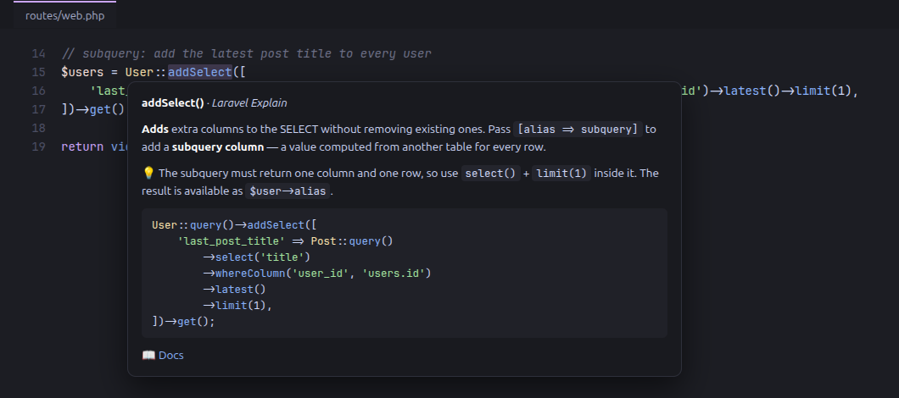

# Laravel Explain

**Hover any Laravel method and get a plain-English explanation, a real example, and a link to the right section of the docs — for the Laravel version your project actually uses.**



Your editor already shows method *signatures*. Laravel Explain shows **what the method does and when to use it** — written for people learning Laravel and for everyone who can't remember whether it was `whereHas` or `withWhereHas`.

## Features

- **Hover explanations** for 450+ of the most-used parts of Laravel:

  | Area | Examples |
  |---|---|
  | Eloquent & Query Builder | `where`, `addSelect`, `whereColumn`, `with`, `whereHas`, `withCount`, `paginate`, `upsert`, relations |
  | Collections | `map`, `filter`, `pluck`, `groupBy`, `firstWhere`, `partition`, `flatMap` |
  | Migrations | `Schema::create`, `$table->foreignId()`, `->constrained()`, `->cascadeOnDelete()`, `->nullable()` |
  | Routes & Requests | `Route::resource`, `->name()`, `->middleware()`, `$request->validate()`, `$request->boolean()` |
  | Validation rules | hover `required`, `unique`, `exists`, `confirmed`, `max` inside `'required\|email\|max:255'` |
  | Str, Arr, dates & helpers | `Str::slug`, `Arr::get`, `now()->addDays()`, `diffForHumans`, `route()`, `old()`, `abort_if()` |
  | Blade directives | `@foreach`, `@forelse`, `@csrf`, `@method`, `@error`, `@class`, `@can`, `@props`, `@vite` |

- **Context-aware** — `Route::get()` explains routing, `->get()` explains running a query, `Arr::get()` explains arrays. Properties like `$user->name` and your own methods are left alone.
- **Docs for your version** — reads `laravel/framework` from your `composer.lock` and links to `laravel.com/docs/{your version}`. Newer features show a warning when your project is too old for them.
- **Search the whole reference** — `Ctrl+Shift+P` → **Laravel Explain: Search Laravel reference**. Fuzzy-search everything, open an entry in a side panel, insert its example at the cursor, or jump to the docs.
- Works alongside Intelephense, the official Laravel extension and every other PHP extension — it only adds an extra section to the hover.

## Settings

| Setting | Default | Description |
|---|---|---|
| `laravelExplain.docsVersion` | `auto` | `auto` detects the version from `composer.lock` (falls back to `13.x`). Set e.g. `12.x` or `master` to pin it. |

## Contributing

Missing a method? Found an explanation that could be clearer? Entries are plain JavaScript objects — adding one takes a minute and **no build step**. See [CONTRIBUTING.md](CONTRIBUTING.md).

```js
// data/eloquent.js
whereColumn: {
  what: 'Compares **two columns** with each other instead of a column with a value.',
  example: "User::query()->whereColumn('updated_at', '>', 'created_at')->get();",
  docs: 'queries#additional-where-clauses',
},
```

## License

[MIT](LICENSE). Laravel is a trademark of Taylor Otwell. This is a community project and is not affiliated with or endorsed by Laravel.
